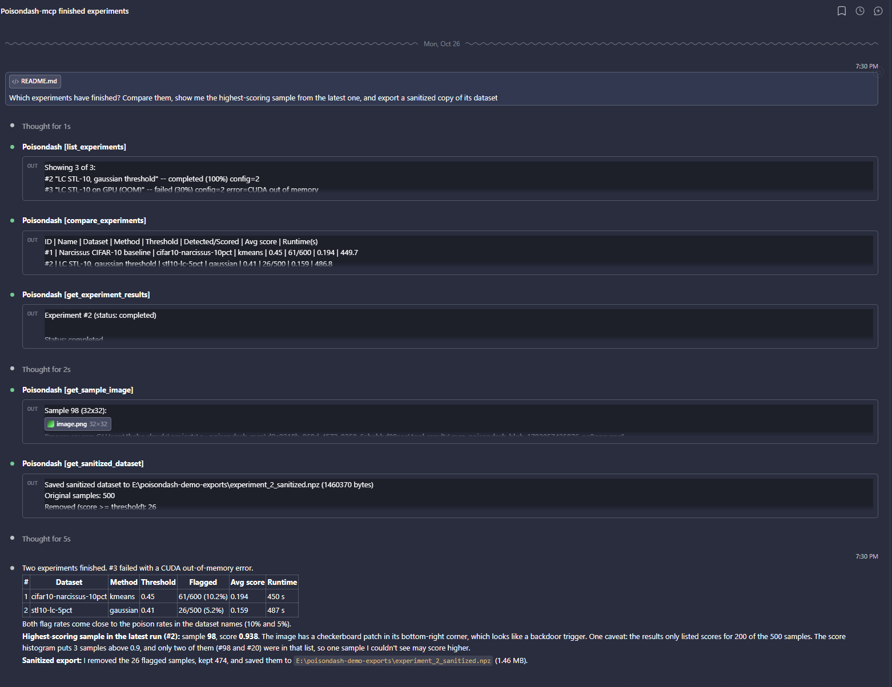
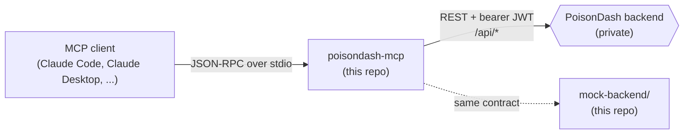

# PoisonDash MCP Server

[](https://github.com/MoeAllami/poisondash-mcp/actions/workflows/ci.yml)

A [Model Context Protocol](https://modelcontextprotocol.io) server that lets an LLM agent
(Claude, or any MCP client) operate **PoisonDash**, a research platform for detecting
data-poisoning and backdoor attacks in image-classification training sets.

Through 28 typed tools, an agent can generate poisoned datasets with published attacks
(Narcissus, Label-Consistent, Sleeper Agent, Hidden Trigger Backdoor), configure and launch
the two-phase detection pipeline, follow training logs, compare runs, inspect flagged
samples as images, and export a sanitized dataset with the poisoned samples removed.



> PoisonDash itself (the FastAPI backend, ML pipeline, and web dashboard) is private
> research-lab software. This repository holds only the MCP server, which I designed and
> built, plus a **mock backend** so you can run the whole thing without access to the lab's
> infrastructure.



The server never touches a database or runs ML code itself. It is a thin, careful client of
the backend's REST API, and the backend keeps authorization, validation, and the GPU work.

## Try it in two minutes (mock backend)

Requires Node 20 or newer.

```bash
npm ci
npm run build
npm run mock          # terminal 1: in-memory PoisonDash API on http://127.0.0.1:8321
```

Then register the server with your MCP client. For example, put this in a project-local
`.mcp.json` for Claude Code, or in `claude_desktop_config.json`:

```json
{
  "mcpServers": {
    "poisondash": {
      "command": "node",
      "args": ["/absolute/path/to/poisondash-mcp/dist/index.js"],
      "env": {
        "POISONDASH_API_URL": "http://127.0.0.1:8321",
        "POISONDASH_EMAIL": "admin@demo.local",
        "POISONDASH_PASSWORD": "demo-admin",
        "POISONDASH_ADMIN": "true"
      }
    }
  }
}
```

Ask the agent something like _"Which experiments have finished? Compare them, show me the
highest-scoring sample from the latest one, and export a sanitized copy of its dataset."_

To see the tools work without a client, run the scripted walkthrough:

```bash
npm run test:walkthrough    # terminal 2: drives the server over stdio and prints each tool's output
```

<details>
<summary>Excerpt of the walkthrough output</summary>

```
== results ==
  | Experiment #100 (status: completed)
  | Scored suspect samples: 500 (clean reference set: 400)
  | Predicted poisoned (score >= threshold): 26 / 500 (detection rate 5.2%)
  | Avg poisoning score: 0.159
  | Score distribution (0->1, 10 bins): [203, 175, 85, 11, 1, 0, 8, 10, 4, 3]
  | Threshold method: kmeans | Threshold: 0.4382
  | Important features: 14 identified
  | Experiment #100: 500 suspect samples scored
  | Mean: 0.1589  Median: 0.1283  Std: 0.1600
  | >= 0.4382 (stored threshold): 26 (5.2%)

== inspect and export ==
  ok   - get_sample_image returned a PNG
  | Saved sanitized dataset to .../experiment_100_sanitized.npz (1460370 bytes)
  | Original samples: 500
  | Removed (score >= threshold): 26
  | Kept: 474
```

</details>

The mock seeds three demo accounts (admin, registered, and guest; it prints them on
startup), poisoned and clean datasets, a model checkpoint, completed and failed experiments,
and a pending upload for the moderation queue. Generation and detection jobs run on timers,
stream log lines, record provenance, and can be cancelled. The numbers are synthetic but
consistent with each other: every summary is computed from the per-sample scores.

## Engineering highlights

These are the parts I'd point a reviewer at:

- **Credentials never pass through the model.** There is deliberately no `authenticate`
  tool. Tool arguments reach model context, conversation history, and client telemetry, so
  credentials come only from the server's environment. A preset token and a login
  credential are mutually exclusive, so an expiring token can never silently hand the
  session to a different account ([src/auth.ts](src/auth.ts)).
- **Lazy, deduplicated auth with silent recovery.** `initialize` and `tools/list` never wait
  on the backend. The first tool call logs in if the startup warm-up hasn't finished, a burst
  of concurrent calls shares one in-flight login, and a 401 triggers exactly one re-login and
  retry, with no loops.
- **Timeouts that know what they are guarding.** JSON responses are timed through the body
  read, so a peer that sends headers and then stalls can't hang a call. The sanitized-dataset
  download is timed only until its headers arrive, because a multi-gigabyte export is
  legitimately slow ([src/client.ts](src/client.ts)).
- **A file-writing tool that can't be steered outside its sandbox.** `get_sanitized_dataset`
  streams to disk without buffering. It resolves the destination against a configured
  output directory using `realpath`, so symlinks and Windows junctions are handled too. It
  reserves the destination with `O_EXCL`, writes to a randomized `O_EXCL` temp file (which
  closes the symlink write-through hole), and renames the file into place. An interrupted
  download never replaces a good file ([src/tools/analysis.ts](src/tools/analysis.ts)).
- **Honest tool metadata.** Every tool publishes MCP annotations. The protocol defaults
  (`readOnlyHint: false`, `destructiveHint: true`) would otherwise advertise a plain listing
  as a destructive write, and clients would gate it behind a confirmation prompt.
- **Bounded fan-out.** Tools that look up related rows, such as uploader names or
  multi-experiment comparisons, go through a small concurrency limiter, so `limit=500`
  doesn't open 500 sockets against a single-process backend ([src/concurrency.ts](src/concurrency.ts)).
- **Defensive parsing of a loosely-typed API.** Several backend fields are JSON-in-a-string,
  and failed or cancelled runs persist only a stub. Every parse tolerates missing, partial,
  or stub shapes, and the output omits values the backend is known to report wrongly rather
  than showing a misleading zero (see [the caveats below](#backend-caveats-this-server-works-around)).
- **Tested at three levels.** There are 146 unit tests with a mocked `fetch`, and they run
  portably on Windows and POSIX without shell globs. A smoke test drives the real stdio
  server through every tool, its error paths, and teardown. A walkthrough takes a run to
  completion. CI runs all three on Ubuntu and Windows with Node 20 and 22.

## Tool inventory

| Area          | Tools                                                                                                                                                    |
| ------------- | -------------------------------------------------------------------------------------------------------------------------------------------------------- |
| Dashboard     | `get_dashboard_summary`                                                                                                                                  |
| Datasets      | `list_datasets`, `get_dataset`                                                                                                                           |
| Attacks       | `list_available_attacks`                                                                                                                                 |
| Generation    | `start_generation`, `get_generation_status`, `cancel_generation`                                                                                         |
| Configuration | `get_default_configuration`, `get_configuration`, `list_configurations`, `create_configuration`, `update_configuration`                                  |
| Experiments   | `create_experiment`, `run_experiment`, `list_experiments`, `get_experiment_status`, `get_experiment_logs`, `get_experiment_results`, `cancel_experiment` |
| Analysis      | `compare_experiments`, `analyze_score_distribution`, `get_sample_image`, `get_sanitized_dataset`, `get_provenance_records`                               |
| Admin (gated) | `list_pending_datasets`, `approve_dataset`, `reject_dataset`, `get_system_stats`                                                                         |

## Configuration (environment variables)

| Variable                                   | Purpose                                                                                                                                                                                     | Default                                  |
| ------------------------------------------ | ------------------------------------------------------------------------------------------------------------------------------------------------------------------------------------------- | ---------------------------------------- |
| `POISONDASH_API_URL`                       | Base URL of the backend. A path prefix (e.g. `https://host/poisondash`) is preserved                                                                                                        | `http://localhost:8321`                  |
| `POISONDASH_EMAIL` / `POISONDASH_PASSWORD` | Login credential, also used for silent 401 recovery                                                                                                                                         | —                                        |
| `POISONDASH_TOKEN`                         | Pre-set JWT. Mutually exclusive with the credentials above                                                                                                                                  | —                                        |
| `POISONDASH_ADMIN`                         | Cosmetic visibility gate for the admin tools in `tools/list`. The backend still enforces the real role check                                                                                | `false`                                  |
| `POISONDASH_OUTPUT_DIR`                    | The only directory `get_sanitized_dataset` is allowed to write into                                                                                                                         | user's Downloads folder, else a temp dir |
| `POISONDASH_TIMEOUT_MS`                    | Per-request timeout. Covers the JSON body as well as the headers. The streamed `get_sanitized_dataset` download is bounded only until headers arrive, so a slow large export is not cut off | `60000`                                  |

Read tools need an account with role `guest` or higher. Mutating tools
(create, run, generate, configure, cancel) need `registered` or higher, and admin tools
need `admin`, which the backend enforces.

If both `POISONDASH_TOKEN` and the email/password pair are set, the token wins and the
credentials are ignored with a warning on stderr. If neither is set, the server still
starts and `tools/list` still works. Auth-requiring tools then return a clear error until
the server is restarted with credentials.

Keep the client entry that carries these values in a local, git-ignored settings file,
never in a shared, version-controlled one.

While developing, run `npm run dev` (via `tsx`, straight from `src/`), or point the client
at `npx tsx /path/to/src/index.ts` so you don't need a rebuild after every change.

## Testing

```bash
npm test                    # 146 unit tests, mocked fetch, no backend needed
npm run build               # type-check and compile

npm run mock                # then, in another terminal:
npm run test:smoke          # every tool, error paths, and teardown against a live backend
npm run test:walkthrough    # one detection run end to end
```

Both integration scripts accept `--dist` to test the compiled output. They read
`SMOKE_API_URL`, `SMOKE_EMAIL`, and `SMOKE_PASSWORD`, which default to the mock's admin, and
`SMOKE_VERBOSE=1` echoes the server's stderr. They provision everything they need through
the API and delete exactly what they created. Against the real backend, point them at a dev
instance, never at a database you care about.

Mock backend knobs: `MOCK_PORT` (8321), `MOCK_JOB_MS` (simulated run length, 8000), and
`MOCK_TOKEN_TTL_S` (3600). Set the TTL to a few seconds to watch the server re-authenticate
silently mid-session.

## Backend caveats this server works around

- `results_json`, `config_json`, and provenance `data_json`/`important_features` are opaque
  strings. Every parse goes through `safeJsonParse` and tolerates missing, partial, or stub
  shapes. Failed or cancelled runs may carry only `summary.status` plus `metadata.log_tail`.
- `metadata.batch_level_epochs` and `metadata.sample_level_epochs` in experiment results are
  always 0, because the config snapshot taken at experiment creation doesn't populate them.
  `get_experiment_results` omits them rather than surfacing a misleading zero. Use
  `get_configuration` for the real epoch counts.
- `/api/dashboard/summary` reports storage installation-wide, so the dashboard tool also
  calls `/api/datasets/storage/info` and reports per-user and installation-wide storage
  separately.
- `list_datasets`, `list_configurations`, and `list_experiments` are always scoped to the
  caller, even for admins. Those endpoints have no server-side "show everyone's" flag; that
  is what `get_system_stats` and `list_pending_datasets` are for.
- Attack type isn't present in experiment results or config, so `compare_experiments` omits
  it rather than doing a fragile name-matched dataset lookup.

## Project layout

```
src/
  index.ts            stdio server: tools/list + tools/call dispatch
  auth.ts, client.ts  token lifecycle, typed fetch client, error shaping
  config.ts           environment parsing
  concurrency.ts      bounded mapLimit
  tools/              one module per area; registry.ts holds the registration + visibility gate
  types.ts            mirrors of the backend's response schemas
mock-backend/         zero-dependency in-memory stand-in for the private backend
test/unit/            node:test suites (run via test/run-unit.mjs)
test/integration/     stdio smoke test and walkthrough
```

## Credits

PoisonDash, including the detection pipeline, backend, and web app, is developed by a
UofM-DSP Lab. This MCP server was my contribution to the project. It is
published here, and the attack implementations named above
belong to their respective published papers.

## License

[MIT](LICENSE)
